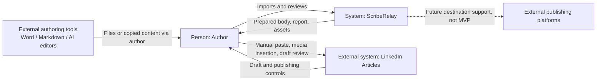

# 5,000 feet — system context

Proposed | Scope: ScribeRelay and external actors/systems.

SR owns conversion and preparation, not authoring or publication. No direct LinkedIn API or automated DOM connection is part of MVP. Authoring tools are sources, not required integrations. Future destinations are conceptual. Trust boundary: external files and clipboard data are untrusted; LinkedIn is outside SR control. See FR-01–10, NFR-01–02 and [feasibility](../feasibility-and-constraints.md).
