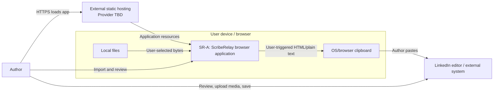

# 2,000 feet — container view

Proposed candidate | C4 container means an independently running/deployable application or data store, not a Docker container.

Only SR-A is a proposed ScribeRelay runtime container. Static hosting is an infrastructure dependency, not a chosen provider. Files and clipboard are device resources. Processing occurs within SR-A; session state and assets remain local. No backend, database, login, analytics or AI service required in this candidate. Persistence and worker execution remain open decisions. Trust boundaries: hosting delivers code; local input is untrusted; clipboard and LinkedIn are outside application control. See NFR-01,02,07 and AC-07.
