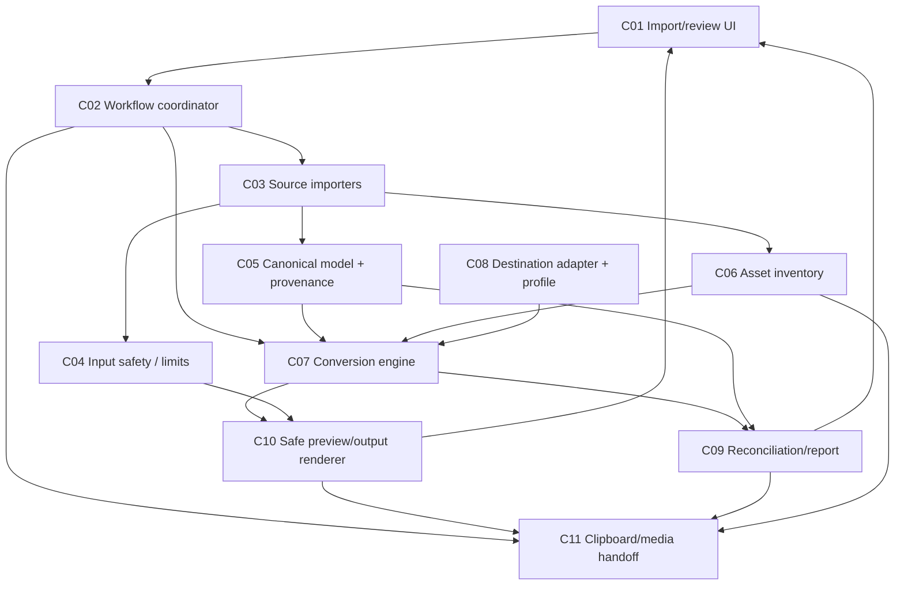

# 1,000 feet — SR-A logical components

Proposed responsibilities inside browser application; arrows represent calls or data flow, not network services.

| ID | Responsibility | Trace |
|---|---|---|
| C01–02 | User actions, workflow state, error/retry and acknowledgement | FR-01,05,06,09; NFR-04 |
| C03–04 | Format recognition, safe parsing, limits and rejection | FR-01–02; NFR-02 |
| C05–06 | Semantic document, stable source identity, media inventory | FR-02,03,07 |
| C07–08 | Deterministic conversion using versioned destination policy | FR-04,10; NFR-03,06 |
| C09 | Account for all inventory elements and disclose uncertainty | FR-05–06; AC-01–05 |
| C10 | Safe representation for preview and export; no external execution | FR-05,08; NFR-02 |
| C11 | User-triggered clipboard and media instructions; explicit fallback | FR-08–09; AC-06 |

Importers must not depend on LinkedIn policy. Profile rules must not mutate original source. Reconciliation compares independent source inventory with conversion outcomes. UI cannot infer actual target persistence. Safety applies before parsing, during resource expansion and before rendering/export. Component boundaries and implementation mapping await M5.
