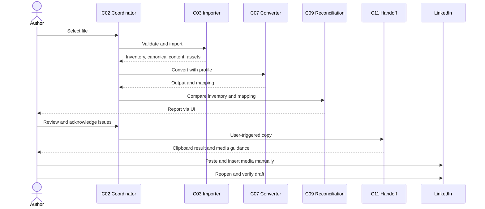

# Ground level — conceptual contracts and runtime scenarios

Proposed; not executable interfaces or approved class design. Formal C4 code diagrams are deferred until implementation types exist.

## Candidate data contracts

| Concept | Minimum information / invariant |
|---|---|
| Source inventory | Stable element ID, kind, order, source locator, original text or recoverable reference; include unknown structures |
| Canonical document | Ordered semantic blocks and inline spans, metadata, asset references, provenance back to inventory |
| Asset | Stable ID, local content or unresolved reference, media type, placement anchor, alt text when available |
| Destination profile | Destination ID, version/date, browser/copy context, evidenced support states, rules and evidence references |
| Conversion outcome | Source ID(s), output reference(s), classification, reason, recovery; every inventory ID accounted for |
| Handoff payload | Separate title, safe HTML and plain text body, media list, report reference and explicit export state |

IDs and reconciliation cardinality must support one-to-many and many-to-one transformations without double-counting. Unknown is not preserved. User edits must be distinguishable from transformations. Reject inputs when reliable accounting is impossible.

## Dynamic view — normal handoff

## Failure paths

| Scenario | Required behavior |
|---|---|
| Invalid/oversized input or unsafe archive | Stop safely; actionable error; no partial-success claim |
| Unsupported structure | Preserve recoverable source or reject; report location and reason |
| Missing or external asset | Do not fetch implicitly; flag and offer local resolution |
| Unknown destination feature | Report unknown; provide safe candidate fallback |
| Clipboard denied | Explain failure; offer tested rich selection fallback, then explicit plain-text recovery |
| User revises conversion options | Recompute output and report against original inventory; invalidate stale acknowledgement |
| Target editor changes content | User verifies externally; record evidence only through approved manual test protocol |

## Pending granular design

M5 will define schema versioning, parsing contracts, sanitization rules, profile format, state transitions, error taxonomy, resource limits, performance strategy, and dependency boundaries. M6 defines threat model and test layers. M7 may introduce actual classes/functions and code diagrams where they clarify implementation. See [acceptance criteria](../../testing/acceptance-criteria.md).
