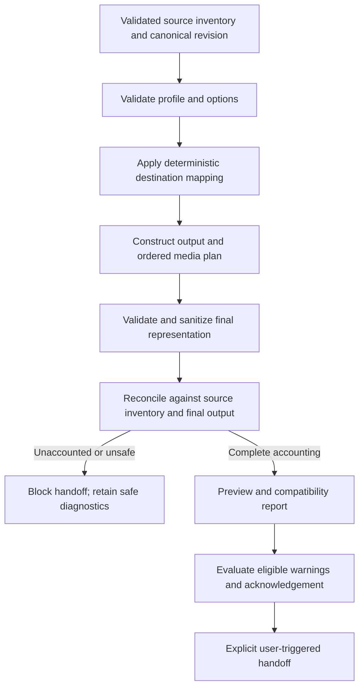

# M5.3 — Conversion specification review

Status: provisional contract proposal; not approved or implemented | 2026-11-25 ET
Task #101 (M5.3.a), parent PBI #68 as recorded in issue. Prerequisites M3.2 and M5.2 remain open. This prepares review only. See [canonical model](canonical-document-model.md), [adapter contract](destination-adapters.md), [handoff design](../design/handoff-and-recovery.md), FR-04–06/10 and AC-01–08/11.

## Conversion boundary

Accept an immutable canonical revision, independent reconciled source inventory, local asset registry, immutable destination profile and explicit options. Reject invalid, unreconciled or unsafe input; do not reinterpret raw source in the adapter. Conversion is local, deterministic and free of implicit I/O. Importers do not depend on destination rules. Output includes a structured destination representation, provenance mapping, report, media plan, and eligibility state; no clipboard write occurs during conversion.

Proposed stages:

If sanitization changes output, record the actual change and reconcile the final safe representation, not a pre-sanitized draft. Safety failure is not a reviewable warning. Recompute from original canonical revision for each option change rather than repeatedly converting already transformed output.

## Classification axes

| Axis | Candidate values | Meaning |
|---|---|---|
| Source accounting | Accounted / unaccounted | Whether source occurrence and authored semantics have a trustworthy mapping or recoverable disposition |
| Conversion disposition | Preserved / transformed / manual action / unsupported / unknown | What happened to the source unit in the proposed local representation |
| Destination evidence | Supported / observed transformed / observed unsupported / unknown / not applicable | What repeatable target evidence establishes for the exact feature and route |
| Handoff readiness | Blocked / review required / eligible | Policy outcome for the current safe revision |
| Actual draft status | Not observed / author-reported / test evidence (separate record) | Never inferred from local preview, copy or acknowledgement |

A locally preserved heading can have Unknown destination evidence. UI must show both axes and their scope, not a green destination success state inferred from local preservation. Report counts use atomic inventory units; structural parent summaries do not inflate totals. Unaccounted is a blocking failure, not an ordinary disposition that acknowledgement can clear.

## Deterministic rule proposals

Apply rules by stable identifier and documented precedence: hard safety and accounting checks first, then exact versioned profile rule for feature/context, then an explicitly permitted alternative, then unknown/unsupported reporting. No default assumption of destination support and no guessing which of two equally applicable conflicting rules wins. Reject ambiguous profiles. Order-sensitive transformations preserve source order unless a named rule explicitly maps and explains changed ordering. Stable diagnostic ordering follows story, source occurrence, then rule identifier. No randomness, clock, external fetch or device-dependent decision enters semantic mapping. Runtime metadata is separate.

| Construct | Candidate local representation / recovery | Destination evidence today |
|---|---|---|
| Paragraph, Unicode, break | Preserve literal authored text and explicit breaks; no undisclosed whitespace normalization | Unknown |
| Heading and emphasis | Preserve semantics in safe representation; map levels/styles only under explicit rule | Unknown |
| Link | Preserve label and approved safe target; unsafe target retained inertly in report, never emitted | Unknown |
| Lists | Preserve order/nesting; if a reviewed flattening rule is used, explain hierarchy changes and retain source | Unknown |
| Quote/divider | Preserve structure where possible; explicit text/boundary fallback | Unknown |
| Table | Preserve ordered cell content; optional reviewed linearization with unambiguous row/cell boundaries, not default data loss | Unknown |
| Code | Preserve literal whitespace and text; disclose style change; safe encoding | Unknown |
| Local media | One placement record per occurrence; local asset and surrounding anchors; no assumption of direct paste | Unknown |
| Missing/external media | Retain original reference inertly; unresolved reason and safe manual recovery; no fetch | Unknown |
| Auxiliary/unsupported constructs | Account for content, retain recoverable reference and disclose omission or reject if reliable accounting impossible | Unknown |

A confirmed title extraction maps source occurrence into a distinct title slot rather than dropping it from accounting. Cover role is distinct from body occurrence. Guidance placeholders are not silently added to copied body. No P1 feature promoted to a P0 requirement.

## Reconciliation contract

Create a total disposition ledger over the atomic source inventory IDs. Each entry has source unit/locator, rule ID/version, disposition, reason, ordered output references (possibly empty), recovery reference, evidence state and blocking/attention classification. Structural parent summaries are derived. Output references identify final safe output locations, including separate title and media slots. One-to-many and many-to-one mappings are valid if explicit; each source unit has exactly one primary ledger entry. Duplicate authored text and repeated images are distinct occurrences.

Check both directions: every atomic source unit is accounted for and every emitted authored fragment maps to source or an explicit generated-value reason. Compare text values and declared normalization, order within each story, multiplicity, link targets, table cell boundaries and asset occurrences; aggregate counts alone are insufficient. A mapping that points to an absent final output is invalid. An empty output mapping requires an explicit supported recovery/omission reason and source evidence; missing accounting blocks success. Do not silently concatenate auxiliary stories into body.

## Review examples (conceptual)

| Case | Expected outcome |
|---|---|
| H1 locally mapped to heading, target unknown | Preserved locally; Unknown target evidence; show verification guidance |
| Two equal strings at different positions | Two ledger entries; missing second occurrence blocks |
| Two images share asset A1 | Two media placements with independent context; one binary asset |
| Table flattened by explicit rule | Transformed; mapping covers each cell in order; visible original and reason |
| Link target rejected during sanitization | No executable target; preserve label and account for removed target; block if safety/accounting cannot be established |
| Final renderer drops a paragraph | Reconciliation against final representation fails; no handoff |
| Profile changes after review | Invalidate eligibility, acknowledgement and previous copy status; recompute |
| Contradictory rules / unknown profile version | Reject profile; no silent fallback to unrelated support |

## Handoff gate and determinism

Only final safe, fully accounted output can enter handoff review. Unresolved but accounted limitations may be eligible for explicit acknowledgement only under owner-approved policy. Acknowledgement binds to source, canonical and output revision, options and profile identity; it cannot waive unsafe/unaccounted states. Copy result describes local operation only and is not part of deterministic semantic output. Failed rich write cannot silently become plain-text success. See M4.3 for provisional UI behavior.

Same input, canonical/model versions, options and profile should produce equivalent normalized output, media plan, mapping and report. Compare without timestamps/session IDs; don't exclude authored values or diagnostic order. M6/M7 must define exact equality and execute regression tests.

No production types, renderer, library or exact policy thresholds selected. Rules and examples are proposals, not validation results. M3.2/#151 and upstream architecture acceptance remain open; no issue closure, compatibility promotion or gate waiver.
