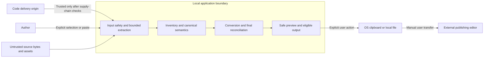

# M6.1 — Security and privacy threat model review

Status: proposed controls and verification plan, not approved or implemented | 2026-11-26 ET
Task #103 (M6.1.a), parent PBI #70 as recorded in issue. M5.1–3 prerequisites remain open. This prepares security review, not formal M6 execution or readiness. Candidate browser-local architecture only; reassess if deployment changes. See [solution architecture](solution-architecture.md), [conversion specification](conversion-specification.md), NFR-01/02/07 and AC-01/07.

## Assets, actors and trust boundaries

Protect authored text, embedded media, source references, provenance, conversion integrity, clipboard contents and application availability. Treat imported files, pasted representations, metadata, asset bytes and external references as untrusted even when the author selected them. Threat actors include a malicious document creator, compromised dependency or delivered application, and an unintended recipient of copied content. Browser/OS compromise, malicious extensions and destination behavior are outside ScribeRelay's direct control; disclose residual risk, do not claim device-wide isolation.

No implicit network edge from source processing to external content providers. Code delivery itself is a separate trust boundary. A worker can protect UI responsiveness but is not by itself a security sandbox. No ScribeRelay LinkedIn credentials, native editor automation or hidden document telemetry.

## Threat register

Ratings are provisional qualitative impact assessments, not measured exploitability or accepted residual risk.

| ID | Threat / boundary | Impact | Proposed mitigation | Verification |
|---|---|---|---|---|
| T01 | Malformed or excessive ZIP/XML; expansion, deep nesting, duplicate or escaping paths | High availability/integrity | Bounded streaming or equivalent pre/during expansion checks, path validation, reject ambiguous entries, cancellation and quotas | S01–S03 |
| T02 | XML entities or external relationship resolution | High privacy/integrity | Reject unsupported declarations/entity processing, disable external resolution, scope relationship identity to source part, no automatic fetch | S03–S04 |
| T03 | Executable HTML, event handlers, dangerous URLs or active embedded objects | High confidentiality/integrity | Inert extraction without attaching raw input to live DOM, conservative allowlist, independent final output safety validation, no active objects | S05–S07 |
| T04 | Image/asset type mismatch or excessive decoding resources | High availability/integrity | Validate actual type and bounded decoded dimensions, size and count; disallow active formats unless separately proven safe; local handles only | S08 |
| T05 | Implicit fetch via images, CSS, links, parsing or preview | High confidentiality | No remote content resolution; inert source references; explicit local recovery; network restrictions as defense in depth | S04/S06/S09 |
| T06 | Parser omission or renderer/sanitizer loses content | High integrity | Independent inventory and ordered bidirectional reconciliation against final safe output; explicit loss report, block unaccounted output | S10 |
| T07 | Stale result, wrong document, clipboard overwrite or silent fallback | High integrity/privacy | Bind review and copy to revision; explicit activation; serialize competing copy operations; distinguish local write, manual fallback and author-reported destination state | S11 |
| T08 | Local persistence, diagnostics or telemetry disclose content | High confidentiality | Session-local default proposal, no mandatory retention, no raw content/hashes/paths in logs, no third-party content telemetry; explicit clearing policy | S09/S12 |
| T09 | Compromised package, build or hosting origin | High confidentiality/integrity | Exact dependency lock, license/advisory review, minimal permissions, reviewed build inputs, immutable deployment artifact, restrictive headers and rollback | S13 |
| T10 | Misleading destination status or malicious profile/rule | High integrity | Versioned data-only profile, validate schema/rules and evidence scope, no executable profile code, never infer editor success | S10/S14 |

## Security contracts for review

- Input limits cover compressed bytes, expanded bytes, per-entry size, entry count, XML depth/nodes/text, decoded image pixels, total memory and cancellation/time budget. Exact values require M3/M5 evidence and reference device measurement; AC-10 proposed fixture sizes are not safe expansion limits.
- Validate paths and scoped relationships before access. Never write package paths to a filesystem or follow external references implicitly. Malformed/unsupported input produces actionable bounded diagnostics, not a successful partial result.
- Keep raw markup inert throughout import, inspection, error display and recovery. A sanitizer alone is not proof that parsing cannot initiate requests. Apply final output safety checks after transformations and reconcile the representation actually copied. Preserve unsafe source values only as inert recoverable evidence.
- Restrict emitted URL schemes and contexts using a reviewed policy and canonicalization; do not treat a simple prefix check as sufficient. Do not dereference links during validation. No event handlers, executable script, active embeds or external style/resource loading in preview.
- For browser candidate review a restrictive CSP and other security headers against required local assets, workers and clipboard route. No inline executable untrusted content, third-party scripts, remote fonts or analytics required. CSP protects app context, not the destination after paste; validate exported markup independently.
- Handoff only current safe, accounted output. Acknowledgement cannot bypass safety or missing accounting. Explicit plain-text fallback warns about formatting loss. No background clipboard reads. Do not promise revocation of an already written OS clipboard item.
- Keep original source and assets local during the session. Default no durable document persistence unless separately approved; release references and revoke local object URLs when no longer needed. Clearing cannot guarantee physical memory erasure or remove clipboard/file copies outside the app. Warn before discarding unsaved recovery context.
- Diagnostics use safe codes and bounded messages; no private fixture, source text, content digest, local path, draft URL or credential in repository, telemetry or CI logs. Sanitized evidence only. No mandatory account/AI. Hosting access logs and browser/device behavior are separate residual privacy considerations.

## Proposed abuse fixture and verification catalog

All fixtures synthetic, small and bounded. This catalog defines cases, not executable payloads or passing tests. Use local isolated test environment; no external editor automation or live external endpoint.

| ID | Fixture / scenario | Required assertion |
|---|---|---|
| S01 | Invalid package, duplicate entry, ambiguous or traversal-like path | Explicit rejection before unsafe expansion/access |
| S02 | Synthetic package exceeds configured entry/expanded-byte quota by small margin; cancellation during parsing | Bounded termination, UI responsive, no stale success |
| S03 | Malformed XML, excessive nesting, unsupported DTD/entity declaration | Safe rejection, no external resolution |
| S04 | Missing/unbound relationship; external media reference | Inert unresolved record, zero implicit requests |
| S05 | Synthetic executable-markup and unsafe URL cases | No execution, unsafe target absent from final output, source accounted |
| S06 | Resource-bearing markup/style/reference in source and preview | No implicit request, even during parsing |
| S07 | Sanitization removes an attribute or node | Actual change reported and final representation reconciled; block if unaccounted |
| S08 | Mismatched media signature, small fixture exceeds configured decoded dimension limit | Reject or explicit safe recovery, no uncontrolled allocation |
| S09 | Offline after application load; instrument local request attempts and storage | Import/preview/copy local, zero document transfers or hidden persistence |
| S10 | Missing/reordered/repeated authored content; contradictory profile | Block invalid mapping or profile; no false destination support |
| S11 | Copy denied, concurrent conversion changes and late response | Explicit failure/stale state, current revision required, no silent fallback |
| S12 | Finish session and inspect diagnostics/local storage | No unauthorized retained content; disclose OS clipboard limits |
| S13 | Dependency/build review and simulated failed release | Approved lock/license/advisory record, least privilege, immutable artifact and rollback procedure |
| S14 | Unknown destination or author-reported verification | Unknown remains visible; no automatic editor success claim |

AC-07 requires both offline success and observation of no document transfer; offline alone does not establish that the online app never attempts requests. Test with network instrumentation before disabling network and use a controlled local harness. Do not treat historical Python ZIP/XML probes as production security validation. #151 remains open.

## Security review and release gates

M6 review must agree threat dispositions, exact limits, source/asset/URL policies, retention, dependency and delivery controls, and verification ownership. M7 must execute applicable abuse/regression cases against actual implementation and record exact versions and evidence. Proposed release blockers: unsafe execution, implicit document transfer, unaccounted content, uncontrolled resource exhaustion, or unresolved critical security defects. No waiver by user acknowledgement. Any other residual risk requires explicit owner disposition and documented scope. M8 release authorization separate.

No runtime tests or abuse fixtures created in this PR; no external security audit, library selection, deployed headers, issue closure or accepted controls. M5 approval and M3 evidence remain outstanding; review again against actual selected runtime before M6 acceptance.
