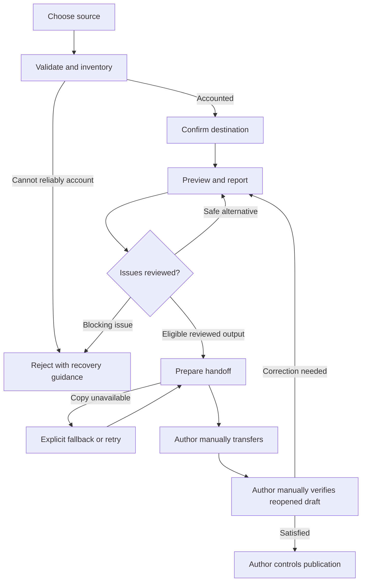

# M4.1 — Author personas, jobs and journeys

Status: proposed design draft; owner review pending | 2026-11-25 ET
Task: #96 (M4.1.a), parent PBI #63 as recorded in issue. Based on the [vision](../product/vision.md), [PRD](../product/product-requirements.md) and [interim feasibility review](../research/feasibility-gate-review.md). M2 acceptance and M3 evidence remain outstanding. These are hypothesis-based personas, not interviewed or validated users.

## Personas and jobs

| Persona | Situation and motivation | Primary job | Success signals |
|---|---|---|---|
| P1 — Technical author (primary) | Has a finished Word or Markdown article with headings, links, code, tables and images; does not want to reconstruct it in another editor | Transfer the authored article faithfully into a LinkedIn Article draft | All text accounted for; structure retained where supported; media recovery clear; less active preparation time |
| P2 — Rich-text creator (secondary) | Has formatted content in an AI tool or another editor; clipboard is the convenient source | Inspect and transfer the rich-text selection without hidden formatting or content loss | Source representation and limitations visible; explicit copy result; safe fallback; no unnecessary account or upload |

Both personas value control of final publication. Neither requires a full authoring studio, automatic publishing or mandatory AI. Do not infer demographics or market size from these personas.

## Common journey and responsibility boundary

| Stage | Author action | ScribeRelay responsibility | Exit / recovery | Requirement |
|---|---|---|---|---|
| 1. Import | Choose local Markdown/DOCX or explicitly paste rich text | Validate source, show progress, identify type and actionable errors | Valid source or explicit rejection; original unchanged | FR-01, NFR-01/02/05 |
| 2. Inspect | Review inventory and source context | Account for text, structures, assets and unsupported material; retain session provenance | Reconciled inventory or stop if accounting impossible | FR-02/03, AC-01 |
| 3. Destination | Confirm LinkedIn Articles | Show profile date, limitations and unknowns | Explicit destination context, no unsupported guarantees | FR-04/10 |
| 4. Preview | Compare source and predicted output | Display destination simulation and per-element report | Understand preservation, changes and unresolved issues | FR-05, AC-02/03 |
| 5. Resolve | Select available safe alternatives; inspect recovery | Explain location, reason and options; recompute report without altering original | Explicitly resolved or acknowledged eligible limitations; unaccounted content blocks success | FR-06/07, AC-04/05 |
| 6. Prepare handoff | Request body copy and inspect media list | Provide explicit clipboard result and separate title/media guidance; failure/fallback visible | User has a usable supported representation or clear recovery | FR-08/09, AC-06 |
| 7. Transfer | Manually open Article editor, paste, insert media | Provide guidance only; no editor interaction or claim of observed draft state | User checks draft, corrects if necessary | FR-09/10 |
| 8. Verify | Save and reopen manually | Offer checklist and source context while session remains available | Author decides whether draft is satisfactory and publishes separately | FR-10, AC-03/06 |

## Conceptual journey states

This describes responsibility and state, not a finalized screen sequence. Exact acknowledgement policy, browser support, media placement interaction and clipboard behavior depend on M4.2/M4.3 and M3 evidence. Acknowledgement cannot waive unaccounted content or unsafe output.

## Representative scenarios

- P1 DOCX with repeated image occurrences and a simple table: source inventory distinguishes occurrences from asset identity, report identifies any predicted structural change, and author receives placement context. Direct image paste is not assumed.
- P1 Markdown with malformed link, unresolved relative image or unsafe HTML: source remains recoverable, report distinguishes inert literal content, unresolved asset and blocked output; no implicit fetch or execution.
- P2 clipboard has plain text only: identify available representation without pretending formatting was imported; allow explicit choice of plain text or retry with original source.
- Any persona with a rejected or oversized document: actionable reason, original retained by author, no misleading successful output. Limits remain to be agreed.
- Any persona with unknown destination fidelity: preview is labeled simulation; author sees limitations and manual verification steps. No automatic claim of successful paste or persistence.

## Cross-cutting experience requirements

Keyboard access, readable status and error messaging, predictable focus, explicit copy activation, no hidden network transfer, and deterministic conversion independent of optional AI. Session retention and recovery-package export remain open decisions; FR-12 is P1, not a required recovery download. Basic preview editing is also P1. Avoid implying that session content persists after closing or reload until a retention policy is approved.

## Review and next steps

Validate persona assumptions with representative authors; review journey against M2 scope. M4.2 (#97) may use these draft states for proposed wireframes subject to relevant M3.2 findings; M4.3 (#98) owns detailed media, acknowledgement and keyboard flow subject to M3.3. No task closure, native relationship changes, production code, approved interaction design or gate acceptance.
