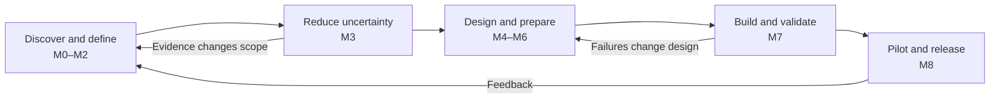
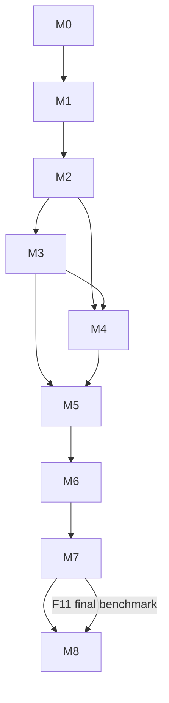

# Milestone execution plan — zoomable delivery map

Version 0.1 | Proposed | 2026-11-25 | Baseline: main 4c21345

This is a C4-inspired planning hierarchy, not the formal C4 software architecture model. Read from strategic outcomes to executable work. The [product roadmap](../product/roadmap.md) remains the scope source; the [PRD](../product/product-requirements.md) and [acceptance criteria](../testing/acceptance-criteria.md) remain the requirement source. No dates, estimates or production stack are committed.

## 5,000 feet — purpose and lifecycle

Author anywhere → Relay faithfully → Publish anywhere.

Success means a user-controlled LinkedIn Article handoff with no silent content loss, measurable reduction in preparation effort, and a local-first conversion experience. Other publishing destinations remain future candidates.

## 2,000 feet — milestone map

| ID | Outcome | Entry | Exit / approval | Status at baseline |
|---|---|---|---|---|
| M0 | Repository and review governance | Project intent | Private repository, protected main and agent guidance | Complete |
| M1 | Discovery baseline | M0 | Owner accepts vision and positioning; research limitations recorded | PR #1 merged; labels proposed |
| M2 | Requirements baseline | M1 direction | Owner approves scope, requirements and measurable targets | PR #4 merged; labels proposed |
| M3 | Feasibility evidence | M2 draft and approved spike scope | Core clipboard/media risks resolved or scope revised; parser evidence recorded | PR #8 merged; experiments pending |
| M4 | Interaction design | M2; relevant M3 findings | Owner approves flows, issue recovery and accessibility | Pending |
| M5 | Architecture | M2, critical M3 findings, M4 | Owner approves boundaries, contracts, stack and ADRs | Pending |
| M6 | Engineering readiness | M5 direction | Security, testing, delivery and release controls approved | Pending |
| M7 | Working MVP | Explicit M2/M5 approval; M6 gates | P0 acceptance, real draft tests and defect gates pass | Pending |
| M8 | Private pilot/release | M7 evidence | Owner authorizes release, support and rollback readiness | Pending |

M4 may be drafted in parallel with M3; do not finalize interactions dependent on unresolved platform behavior. F11 benchmarking requires a functioning conversion candidate: early baseline may be gathered in M3, final comparative measurement belongs in M7/M8. M3 closure does not require a production MVP.

## 1,000 feet — work packages

See [work-package catalog](work-packages.md) for stable IDs, activities, dependencies, artifacts and completion checks. IDs are proposed issue keys, not existing GitHub issue numbers.

## Ground level — tasks and evidence

[Current execution backlog](execution-backlog.md) decomposes actionable M3 work and establishes provisional M4–M8 tasks. [Architecture zoom views](../architecture/c4/README.md) provide a companion system-design hierarchy, deliberately provisional until M5.

Every task record should carry: stable ID, objective, prerequisite IDs, requirement/test references, expected output, completion evidence, owner, status, PR/issue links and unresolved decisions. Split further only when evidence permits. A merged PR is not proof of runtime validation or explicit acceptance.

## Operating rules

- GitHub Markdown is the planning source; issues can reference these IDs without duplicating requirements.
- Owner approves milestone gates and merges; contributors or agents prepare reviewable work.
- Use feature branches, never direct main writes or force pushes.
- Approved isolated synthetic spikes are allowed; production implementation waits for requirements and architecture approval.
- Record blockers and scope revisions in PRs; do not mark unknown capabilities supported.
- Review roadmap and backlog together after each gate. No public branding commitment until clearance.
