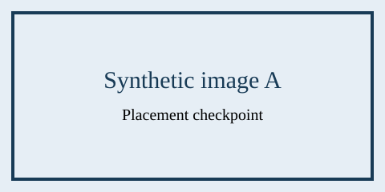

# Synthetic title

## Heading

Unicode: café, తెలుగు, 日本語, αβγ.

**Bold** and *italic* and `inline()`.

[Example](https://example.com/)

1. First
2. Second

- Parent
  - Child

> Quotation

---

| Feature | Value |
| --- | --- |
| Alpha | One |

```js
const value = 42;
```




<span>Raw HTML text</span>

[Unsafe link](javascript:alert%281%29)
